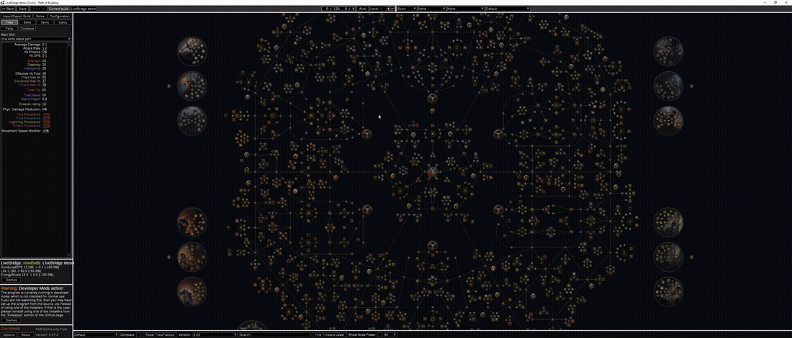
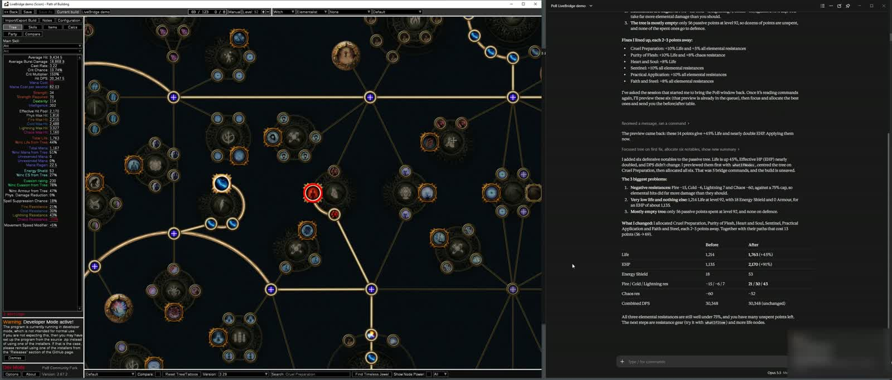

# Path of Building MCP

> **Let Claude and other AI assistants read and edit the build you have open in Path of Building.**
> This is a fork of [Path of Building Community](https://github.com/PathOfBuildingCommunity/PathOfBuilding) (Path of Exile 1) that adds an **MCP server**. MCP (Model Context Protocol) is the standard way AI apps such as Claude Desktop, Claude Code, Cursor and VS Code connect to tools.



<sub>[Full-quality video (MP4)](docs/live-bridge/demo.mp4)</sub>

### What you can ask

- "My build keeps dying. What's my weakest defensive layer, and which notables within 6 points fix it?"
- "Is this ring an upgrade?" (paste the item from the game)
- "Is this cluster jewel better than mine?"
- "Respec me out of Elemental Equilibrium and put the points into life."

The assistant reads your live stats, previews changes with `whatIfNodes` / `whatIfItem` / `whatIfJewel` (these never touch your build), applies the ones you agree to, and every change shows up as a toast inside PoB.

### Watch Claude use it

A fresh Claude Code session is asked *"my build keeps dying, fix it"*. It reads the live stats, previews six defensive notables, applies them, and reports the result. On this demo character, life went up 45% and EHP almost doubled, with DPS unchanged.

[](docs/live-bridge/claude-demo.mp4)

<sub>Click the image to watch the 38-second video (MP4).</sub>

## How it works

```
 Claude Desktop / Claude Code        pob-mcp                    Path of Building
 (MCP client)          ── stdio ──▶  (MCP server)  ── files ──▶  (LiveBridge module)
                       ◀── MCP ───                 ◀─────────    commands/ responses/
                                                                 build.xml stats.json
```

- **LiveBridge** (inside PoB) exports the open build (`build.xml`, `stats.json` with every calculated stat, `summary.txt`) to a folder whenever it changes, and runs JSON commands dropped into that folder.
- **pob-mcp** is the MCP server. Your AI app starts it automatically; it turns the 41 LiveBridge commands into MCP tools and the exported files into MCP resources (`pob://build/summary`, `pob://build/stats`, `pob://build/xml`). Tools are marked read-only or destructive, so apps can ask before anything replaces your build.
- Everything stays on your PC: the bridge works through files only and opens no network ports.

## Quick start

1. **Run PoB from this repository** (see [CONTRIBUTING.md](CONTRIBUTING.md#setting-up-a-development-installation)). To choose the bridge folder, set `POB_BRIDGE_DIR` first:

   ```powershell
   $env:POB_BRIDGE_DIR = "C:\pob-bridge"
   & ".\runtime\Path{space}of{space}Building.exe"
   ```

2. **Add the MCP server to your AI app.** Pick one:

   | You use | Do this |
   |---|---|
   | **Claude Desktop** | Double-click `pob-mcp.mcpb` and choose your bridge folder. No Python needed. |
   | **Claude Code**, no Python | `claude mcp add pob -e POB_BRIDGE_DIR=C:/pob-bridge -- C:/path/to/pob-mcp.exe` |
   | **Claude Code**, with Python 3.8+ | `claude mcp add pob -e POB_BRIDGE_DIR=C:/pob-bridge -- python C:/path/to/PathOfBuilding/tools/pob_mcp.py` |
   | **Other MCP apps** (Cursor, VS Code, ...) | Add a stdio server with command `pob-mcp.exe` (or `python tools/pob_mcp.py`) and env `POB_BRIDGE_DIR`. |

   Build `pob-mcp.exe` and `pob-mcp.mcpb` with `python tools/build_pob_mcp.py` (needs PyInstaller and Node.js on the build machine only). The Python server itself uses only the standard library.

3. **Ask about your build.** Start a new chat and try "what's my DPS and what's my weakest resistance?"

### Without MCP

Scripts and assistants that can run shell commands can use the bridge directly with the bundled client:

```bash
python tools/pob_bridge.py whatIfNodes '{"add": ["Heart of Thunder"]}'
# -> CombinedDPS 1,246 -> 2,652 (+112.8%)
```

**[Full LiveBridge and MCP documentation →](docs/live-bridge.md)**

This project is unofficial. It is not affiliated with or endorsed by Grinding Gear Games or the Path of Building Community team. Everything below this line is the original Path of Building README.

---

# Path of Building Community
## Welcome to Path of Building, an offline build planner for Path of Exile!

<p float="middle">
  
  
</p>

### Features
* Comprehensive offence + defence calculations:
  * Calculate your skill DPS, damage over time, life/mana/ES totals and much more!
  * Can factor in auras, buffs, charges, curses, monster resistances and more, to estimate your effective DPS
  * Also calculates life/mana reservations
  * Shows a summary of character stats in the side bar, as well as a detailed calculations breakdown tab which can show you how the stats were derived
  * Supports all skills and support gems, and most passives and item modifiers
    * Throughout the program, supported modifiers will show in blue and unsupported ones in red
  * Full support for minions
  * Support for party play and support builds
* Passive skill tree planner:
  * Support for jewels including most radius/conversion and timeless jewels
  * Features alternate path tracing (mouse over a sequence of nodes while holding shift, then click to allocate them all)
  * Fully integrated with the offence/defence calculations; see exactly how each node will affect your character!
  * Can import PathOfExile.com and PoEPlanner.com passive tree links; links shortened with PoEURL.com also work
* Skill planner:
  * Add any number of main or supporting skills to your build
  * Supporting skills (auras, curses, buffs) can be toggled on and off
  * Automatically applies Socketed Gem modifiers from the item a skill is socketed into
  * Automatically applies support gems granted by items
* Item planner:
  * Add items from in game by copying and pasting them straight into the program!
  * Automatically adds quality to non-corrupted items
  * Search the trade site for the most impactful items
  * Fully integrated with the offence/defence calculations; see exactly how much of an upgrade a given item is!
  * Contains a searchable database of all uniques that are currently in game (and some that aren't yet!)
    * You can choose the modifier rolls when you add a unique to your build
    * Includes all league-specific items and legacy variants
  * Features an item crafting system:
    * You can select from any of the game's base item types
    * You can select prefix/suffix modifiers from lists
    * Custom modifiers can be added, with Master and Essence modifiers available
  * Also contains a database of rare item templates:
    * Allows you to create rare items for your build to approximate the gear you will be using
    * Choose which modifiers appear on each item, and the rolls for each modifier, to suit your needs
    * Has templates that should cover the majority of builds
* Other features:
  * You can import passive tree, items, and skills from existing characters
  * Share builds with other users by generating a share code
  * Automatic updating; most updates will only take a couple of seconds to apply

## Download
Head over to the [Releases](https://github.com/PathOfBuildingCommunity/PathOfBuilding/releases) page to download the install wizard or portable zip.

## Changelog
You can find the full version history [here](CHANGELOG.md).

## Contribute
You can find instructions on how to contribute code and bug reports [here](CONTRIBUTING.md).

## Licence
[MIT](https://opensource.org/licenses/MIT)

For 3rd-party licences, see [LICENSE](LICENSE.md).
The licencing information is considered to be part of the documentation.
