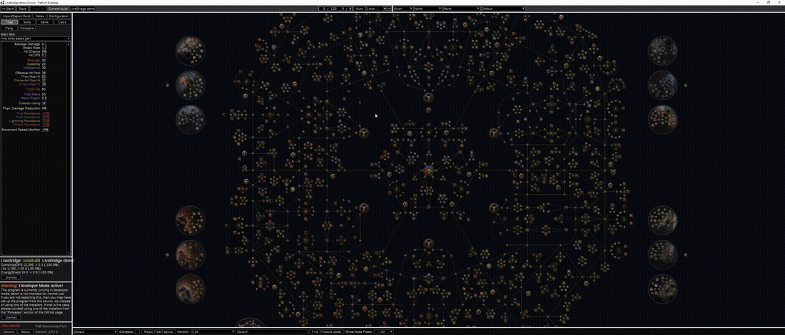
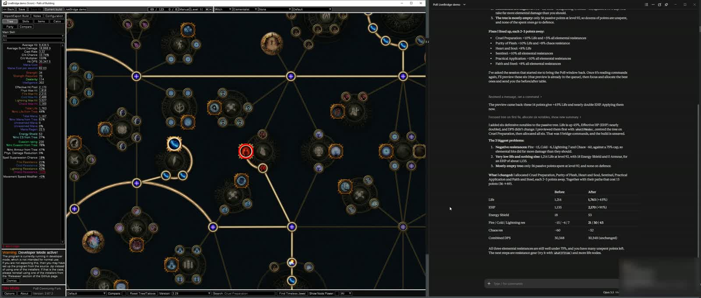

# LiveBridge and MCP: drive Path of Building from AI assistants and scripts

LiveBridge connects Path of Building to other programs through a folder on disk.
Scripts, bots and AI coding assistants such as Claude Code can use it to:

- **read** the open build at any time: the full build XML plus every calculated stat, rewritten whenever the build changes;
- **change** the build: import builds, allocate passives and masteries, add items and gems, set the level, change Configuration options and more;
- **test changes first**: find out how much DPS, life or resistance a node or item would add without touching the build;
- **see the results**: every command shows a toast inside PoB with the stat changes, so you can follow along as an assistant edits your build.



Full-quality video: [`docs/live-bridge/demo.mp4`](live-bridge/demo.mp4). In the demo a script builds an Elementalist from scratch, previews and allocates passives, equips a ring and changes the boss configuration. Each step shows up as a toast in the bottom-left corner.

---

## Contents

1. [How it works](#how-it-works)
2. [Quick start](#quick-start)
3. [Files in the bridge folder](#files-in-the-bridge-folder)
4. [Command protocol](#command-protocol)
5. [Command reference](#command-reference)
6. [Using it with an AI assistant](#using-it-with-an-ai-assistant)
7. [Configuration](#configuration)
8. [Security notes](#security-notes)
9. [Limitations](#limitations)
10. [Development](#development)

---

## How it works

```
 ┌──────────────────┐   commands/<id>.json    ┌──────────────────────────┐
 │  your script /   │ ──────────────────────▶ │  Path of Building        │
 │  AI assistant    │                         │  (LiveBridge module)     │
 │                  │ ◀────────────────────── │                          │
 └──────────────────┘   responses/<id>.json   │  on every recalculation: │
          ▲                                   │   build.xml              │
          └────────── reads ───────────────── │   stats.json             │
                                              │   summary.txt            │
                                              └──────────────────────────┘
```

- PoB checks `commands/` for new files about 10 times a second and runs one command at a time, in file-name order.
- A command that changes the build is answered only after PoB has finished recalculating. Its response includes the new key stats and a before/after `diff`.
- Separately, `build.xml`, `stats.json` and `summary.txt` are rewritten whenever the build is recalculated or you switch tabs. This includes changes you make by hand in the UI.

The bridge only reads and writes files. It opens no network ports.

## Quick start

1. **Run PoB from this repository** (see [CONTRIBUTING.md](../CONTRIBUTING.md#setting-up-a-development-installation)):

   ```bash
   git clone <this repository>
   ./runtime/Path{space}of{space}Building.exe
   ```

   To choose where the bridge folder goes, set `POB_BRIDGE_DIR` before you start PoB:

   ```powershell
   $env:POB_BRIDGE_DIR = "C:\pob-bridge"
   & ".\runtime\Path{space}of{space}Building.exe"
   ```

2. **Send commands** with the bundled client. It needs Python 3.8 or later and uses only the standard library:

   ```bash
   python tools/pob_bridge.py ping
   python tools/pob_bridge.py summary
   python tools/pob_bridge.py findNodes query="cast speed" type=Notable limit=5
   python tools/pob_bridge.py whatIfNodes '{"add": ["Heart of Thunder"]}'
   python tools/pob_bridge.py allocNode name="Heart of Thunder"
   python tools/pob_bridge.py addItem --text-file my_ring.txt slot="Ring 1"
   ```

   Arguments can be `key=value` pairs, where values are parsed as JSON when possible, or a single JSON object.

3. **Or use it as a library:**

   ```python
   from pob_bridge import PoBBridge

   pob = PoBBridge("C:/pob-bridge")
   print(pob.summary())
   result = pob.call("whatIfNodes", add=["Elemental Equilibrium"])
   for stat, d in result["diff"].items():
       print(f"{stat}: {d['before']:.0f} -> {d['after']:.0f}")
   ```

4. **Check your install** with the end-to-end self-test. It creates a throwaway build in the running PoB, so save your work first:

   ```bash
   python tools/bridge_selftest.py
   ```

## Files in the bridge folder

| File | Written | Contents |
|---|---|---|
| `build.xml` | on change | The full build in PoB's normal save format. You can load it into PoB or parse it. |
| `stats.json` | on change | Build name, class, ascendancy, level, open tab, main skill, socket groups and gems, equipped items, passive point counts, keystones, notables, `keyStats` (about 30 headline numbers) and `stats` (every number PoB calculated, several hundred of them). Minion builds also get `minionStats`. |
| `summary.txt` | on change | A seven-line summary that is easy to `cat`. |
| `commands/` | by clients | Queue of command files. |
| `responses/` | by PoB | One response per command, named after the command id. |

All files are written to a temporary file first and then renamed, so readers never see a half-written file.

## Command protocol

**Request.** Write `commands/<id>.json`. Write it to `<id>.json.tmp` first and then rename it, because PoB only picks up `*.json` files:

```json
{ "id": "1731571234000-ab12", "cmd": "allocNode", "args": { "name": "Heart of Thunder" } }
```

- `id` (optional): any string of letters, digits, `-`, `_` and `.`. It defaults to the file name. Commands run in **file-name order**, so start ids with a timestamp.
- `cmd`: the command name. Names are case-sensitive.
- `args`: an object. Its contents depend on the command.

**Response.** PoB writes `responses/<id>.json`:

```json
{
  "id": "1731571234000-ab12",
  "cmd": "allocNode",
  "ok": true,
  "result": { "allocated": [ { "id": 56716, "name": "Heart of Thunder", "pointsSpent": 14 } ] },
  "diff": {
    "CombinedDPS": { "before": 1246.3, "after": 2652.3, "change": 1406.0, "percent": 112.8 }
  },
  "keyStats": { "CombinedDPS": 2652.3, "Life": 1125, "FireResist": -60 }
}
```

- `ok: false` comes with an `error` message.
- `diff` and `keyStats` appear only on commands that change the build. `diff` lists only the key stats that actually changed.
- Clients should delete a response after reading it. The bundled client does this for you.

## Command reference

`ref` means a passive node's numeric **id** or its **name**. Names match without regard to case. Many small passives share a name, such as "Strength" or "+10 to Intelligence". For those, `allocNode` picks the closest unallocated node and `deallocNode` picks an allocated one. Use `findNodes` to get exact ids.

### Reading state

| Command | Args | Result |
|---|---|---|
| `ping` | – | `pong`, current mode, bridge version and PoB version |
| `help` | – | list of command names |
| `getState` | `allStats?` | the same summary as `stats.json`. The full `stats` table is included only with `allStats: true`. |
| `getStats` | `stats?: [names]` | the stats you name, or all of them |

### Builds

| Command | Args | Notes |
|---|---|---|
| `listBuilds` | – | `.xml` files in the PoB build folder (top level only) |
| `openBuild` | `name` | opens `<build folder>/<name>.xml` |
| `newBuild` | `name?` | new empty build |
| `importBuild` | `code` **or** `xml`, `name?` | `code` is a PoB build code, as produced by Import/Export → Generate. Replaces the open build without asking for confirmation. |
| `importCharacter` | `account`, `character`, `realm?` (`pc`), `newBuild?` (true), `name?`, `deleteJewels?` / `clearItems?` / `clearSkills?` (true), `ignoreWeaponSwap?` (false) | Imports a character's passive tree, jewels, items and skills from its **public** pathofexile.com profile, like Import/Export → "Import from website", without any confirmation popup. `account` needs its discriminator (`name#1234`). By default the character goes into a new build, so the open build is left alone; `newBuild: false` imports into the open build instead. `name` also saves the result under that file name in the build folder. The response arrives once the download and recalculation are done (usually a few seconds) and summarises the build: `level`, `class`, `ascendancy`, `mainSkill`, `passives`, `equippedItems`, `socketGroups`, `dps`. |
| `exportCode` | – | `{ code }`: a shareable PoB build code |
| `save` | `name?` | Saves the open build. `name` saves under a new file name in the build folder (no paths allowed). |

### Character

| Command | Args |
|---|---|
| `setLevel` | `level` (1–100). Turns off automatic level mode. |
| `setClass` | `class`, e.g. `"Witch"`. **Resets the passive tree** when the new class's start is not connected. |
| `setAscendancy` | `ascendancy`, e.g. `"Elementalist"` or `"None"`. Switches class automatically if needed. |

### Passive tree

| Command | Args | Notes |
|---|---|---|
| `findNodes` | `query?`, `type?`, `allocated?`, `limit?` (30), `searchStats?` (true) | Searches names and stat text. `type` is one of `Normal`, `Notable`, `Keystone`, `Mastery`, `Socket`. Results are sorted with allocated nodes first, then by distance, and include `pointsToReach`. |
| `getNode` | `id` or `name` | Node details. For a mastery, also the available `masteryOptions` (`effectId`, `stats`). |
| `allocNode` | `id`, `name` or `nodes: [ref,...]`; `mastery?` | Allocates the node and the shortest path to it. A mastery needs `mastery`, either an effect id or text to match, e.g. `"Effect of Shock"`. |
| `deallocNode` | `id`, `name` or `nodes: [...]` | Also removes every node that depends on it, as a right-click does. |
| `resetTree` | – | Unallocates everything. |
| `importTreeUrl` / `exportTreeUrl` | `url` / – | pathofexile.com passive tree links |
| `whatIfNodes` | `add?: [ref]`, `remove?: [ref]`, `stats?: [names]` | **Does not change the build.** Returns `diff` for allocating the nodes (including their paths) and/or removing them. |

### Items

| Command | Args | Notes |
|---|---|---|
| `listItems` | `text?` | `equipped` (by slot) and every item in the build. `text: true` also returns the raw item text. |
| `addItem` | `text`, `slot?`, `equip?` (true) | `text` is the item exactly as copied in-game with Ctrl+C, or from trade sites. The slot is detected automatically. |
| `equipItem` | `slot`, `itemId` | `itemId: 0` empties the slot. |
| `removeItem` | `itemId` | Deletes the item from the build. |
| `whatIfItem` | `text`, `slot?`, `stats?` | **Does not change the build.** Returns the `diff` for swapping the item into the slot. |

Slot names follow PoB: `Weapon 1`, `Weapon 2`, `Helmet`, `Body Armour`, `Gloves`, `Boots`, `Amulet`, `Ring 1`, `Ring 2`, `Belt`, `Flask 1`–`Flask 5`, and so on.

### Jewels and cluster jewels

`socket` is the socket's node id, its slot name (`Jewel 26725`), or the start of the name of the jewel in it (`Hypnotic Bliss`).

| Command | Args | Notes |
|---|---|---|
| `listJewelSockets` | `all?` | Allocated jewel sockets with their jewel and, for cluster jewels, how many of the added passives are allocated. `all: true` includes unallocated sockets. |
| `clusterNodes` | `socket` | Passives a cluster jewel added (id, name, stats, allocated), with nested cluster jewels under their socket. Use the ids with `allocNode` / `deallocNode`. |
| `socketJewel` | `socket`, `text` or `itemId` | Puts a jewel in the socket. `text` adds the jewel to the build first. `itemId: 0` empties the socket. Cluster passives that sit at the same position stay allocated. |
| `allocClusterNodes` | `socket`, `nodes?` | Allocates every passive the cluster jewel added, or only the listed names / ids. |
| `whatIfJewel` | `socket`, `text` or `itemId`, `allocate?` (`"all"`), `stats?` | **Does not change the build.** Swaps the jewel into the socket on a copy of the tree, allocates its passives (`"all"`, `"none"`, or a list of names / ids) and returns the `diff`, `pointsUsed` and the added passives. Medium cluster jewels in its sockets stay in place. |

### Skills

| Command | Args | Notes |
|---|---|---|
| `listSkills` | – | Socket groups (`index`, `label`, `slot`, `enabled`, `isMain`, `activeSkills`, `gems`). |
| `addSkillGroup` | `gems`, `label?`, `slot?`, `main?` | `gems` entries are names (`"Spell Echo Support"` or `"Spell Echo"`) or `{ name, level?, quality?, enabled? }`. Names PoB does not recognise are returned in `unknownGems`. |
| `editSkillGroup` | `index`, then any of `label`, `enabled`, `slot`, `gems` (replaces all gems), `setGems: [{ name, level?, quality?, enabled? }]` | `setGems` changes gems already in the group, matched by name with or without " Support". It must be a list. If any name matches no gem in the group, the command fails and lists the group's gems, and no gem is changed. The result lists `updatedGems`. When `gems` replaces the group, each gem keeps the skill part (e.g. Tornado Shot's "Combined Average Projectiles") of the old gem with the same name; a gem entry can also set `skillPart` (a number) directly. `diff` is empty when the group is not the main skill. |
| `removeSkillGroup` | `index` | |
| `setMainSkill` | `index` **or** `name` (active skill name), `activeSkill?` | Sets the skill shown in the sidebar and used for DPS. |

### Configuration tab

| Command | Args | Notes |
|---|---|---|
| `listConfig` | `query?`, `changedOnly?` | Lists options with `var`, `label`, `type`, current `value` and, for drop-downs, the allowed `options`. |
| `setConfig` | `var` + `value`, and/or `values: { var: value }`, and/or `unset: [var]` | Checkboxes take `true`/`false`, counts take numbers and lists take one of the `options`. `unset` restores the default. |

### UI

| Command | Args | Notes |
|---|---|---|
| `setView` | `tab`: `tree`, `skills`, `items`, `calcs`, `config`, `notes`, `party`, `import` | |
| `focusNode` | `id`/`name`, `highlight?` (true) | Switches to the tree, centres on the node and highlights it with tree search. |
| `notes` | `text?` | Reads the Notes tab, or replaces its text. |

## Using it with an AI assistant

### MCP server (recommended)

[`tools/pob_mcp.py`](../tools/pob_mcp.py) is an MCP (Model Context Protocol) server, so any MCP app (Claude Desktop, Claude Code, Cursor, VS Code, ...) can use the bridge with no prompt setup. It speaks MCP over stdio and uses only the Python standard library.

- **Tools**: every command in the [command reference](#command-reference), with the same names and arguments (`save` included). Each tool carries MCP annotations: preview and read commands are `readOnlyHint`, and commands that replace or wipe the build (`openBuild`, `newBuild`, `importBuild`, `importCharacter`, `setClass`, `resetTree`, `importTreeUrl`, `removeItem`, `removeSkillGroup`) are `destructiveHint`.
- **Resources**: `pob://build/summary`, `pob://build/stats` and `pob://build/xml`, the three exported files.
- **Instructions**: the server tells the assistant to preview with the `whatIf*` commands before changing anything and never to replace the build unless asked.
- The bridge folder comes from `--dir`, then `POB_BRIDGE_DIR`, then the default location.

| App | Setup |
|---|---|
| Claude Desktop | Install `pob-mcp.mcpb` (double-click) and choose the bridge folder. |
| Claude Code | `claude mcp add pob -e POB_BRIDGE_DIR=C:/pob-bridge -- C:/path/to/pob-mcp.exe`, or `... -- python C:/path/to/tools/pob_mcp.py` |
| Others | stdio server: command `pob-mcp.exe` or `python tools/pob_mcp.py`, env `POB_BRIDGE_DIR`. |

`python tools/build_pob_mcp.py` builds the standalone `build/pob-mcp/pob-mcp.exe` (PyInstaller, so users need no Python) and `build/pob-mcp/pob-mcp.mcpb` (a Claude Desktop extension; packed and validated with `npx @anthropic-ai/mcpb`).

If PoB is not running, a tool call fails after its timeout and the command is withdrawn from the queue, so it does not run later by surprise.

### Shell client

AI assistants that can run shell commands, such as Claude Code, Codex CLI or Cursor, can also use the bridge with no MCP setup. Point the assistant at the bridge folder and the client. For example, put this in your project's `CLAUDE.md` or `AGENTS.md`:

```markdown
## Path of Building
Path of Building is running with LiveBridge. The bridge folder is C:/pob-bridge.
- To see my current build: read C:/pob-bridge/summary.txt (quick) or stats.json (full).
- To act on it: `python C:/path/to/PathOfBuilding/tools/pob_bridge.py <command> key=value ...`
  (set POB_BRIDGE_DIR=C:/pob-bridge). Commands are documented in docs/live-bridge.md.
- Always use whatIfNodes / whatIfItem / whatIfJewel to evaluate a change before applying it, and
  tell me the expected DPS / EHP difference.
- Never call importBuild, newBuild, openBuild or resetTree unless I ask; they replace my build.
```

Here is what that looks like: Claude Code on the right is asked to make a fragile build tankier and drives PoB on the left ([video, 38 s](live-bridge/claude-demo.mp4)):

[](live-bridge/claude-demo.mp4)

Then you can ask things like:

- "What's my weakest defensive layer right now?" The assistant reads `stats.json`.
- "Find the three notables within 6 points that add the most DPS." It runs `findNodes`, then `whatIfNodes` for each candidate.
- "Is this ring an upgrade?" (paste the item). It runs `whatIfItem`.
- "Is this cluster jewel better than mine?" (paste the item). It runs `whatIfJewel`.
- "Respec me out of Elemental Equilibrium and put the points into life." It runs `deallocNode`, `findNodes` and `allocNode`, and you watch the toasts as it works.

## Configuration

| Environment variable | Default | Effect |
|---|---|---|
| `POB_BRIDGE_DIR` | `<PoB user folder>/LiveBridge` | Where the bridge reads and writes. In dev mode the user folder is `src/`. For installed builds it is `Documents/Path of Building/`. |
| `POB_BRIDGE` | enabled | `0` turns LiveBridge off completely. |
| `POB_BRIDGE_TOAST` | enabled | `0` hides the in-app activity toasts. |

The Python client uses `POB_BRIDGE_DIR` too, or `--dir`.

## Security notes

- Any program running as your Windows user that can write to the bridge folder can control the open build. That user can already change your PoB files directly, so this gives them nothing new, but keep the folder out of shared or synced locations.
- Build names in `save` and `openBuild` are limited to plain file names inside the build folder.
- Commands never run code. They can only call the fixed set of actions listed above.
- The bridge makes no network connections, except for `importCharacter`, which downloads the named character from pathofexile.com using the same requests as PoB's own "Import from website".

## Limitations

- Path of Exile 1 (Community fork) only.
- `importCharacter` works only for public profiles (pathofexile.com → Privacy settings → "Hide characters" off). Like the website import in PoB, it cannot read bandit or pantheon choices, and the main skill is PoB's usual guess (the largest socket group), which may be a group with no active skill. Use `setMainSkill` afterwards.
- Timeless jewel conversions and tattoos are not yet editable through commands. Their effects are still included in every stat.
- `whatIfJewel` compares against the passive points it reports in `pointsUsed`; it does not take points back elsewhere in the tree. A swap that needs more points than you have still shows the stats, so check `pointsUsed`.
- Undo history: commands record undo states, so Ctrl+Z works per tab as usual. There is no single undo for a whole command sequence. Use `exportCode` before experimenting and `importBuild` to roll back.
- One PoB instance per bridge folder. PoB itself only allows one instance at a time.
- **Background use (Windows).** The PoB runtime normally skips frames while its window is unfocused, which would stall the command queue. The bridge keeps PoB processing commands in the background (covered, minimized, or behind a fullscreen game), including when PoB starts in the background. While idle in the background it limits itself to about 10 frames per second, and to 4 per second after 3 seconds without commands, so the first command after a quiet period can take up to about 0.5 s. Set `POB_BRIDGE_BACKGROUND=0` to turn this off and get the runtime's default behaviour back; then keep PoB in the foreground while commands run. On other platforms PoB must stay in the foreground.

## Development

- Bridge module: [`src/Modules/LiveBridge.lua`](../src/Modules/LiveBridge.lua). Hooks: two small calls in `src/Modules/Main.lua` and `src/Modules/Build.lua`.
- To add a command, add `commands.myCommand = function(args) ... return result, mutated end`. Return `mutated = true` when the command changes the build, so the response waits for recalculation and includes `diff`.
- A command that has to wait (for a download, say) returns `nil, "async", step`. The bridge calls `step()` once per frame on the main thread until it returns `true, result` or raises an error; other commands queue behind it. Do not use a coroutine for this: `launch:DownloadPage` crashes the runtime when called from inside one.
- Run `python tools/bridge_selftest.py` against a running PoB before you submit changes.

## Changelog

- **1.2.0** (2026-11-21): adds jewel and cluster jewel commands: `listJewelSockets`, `clusterNodes`, `socketJewel`, `allocClusterNodes` and `whatIfJewel`.
- **1.1.0** (2026-11-15): adds `importCharacter` (import from a public pathofexile.com profile with no popups) and support for asynchronous commands.
- **1.0.0** (2026-11-14): first release. Adds state export, 36 commands, what-if previews, activity toasts, the Python client and the self-test.
